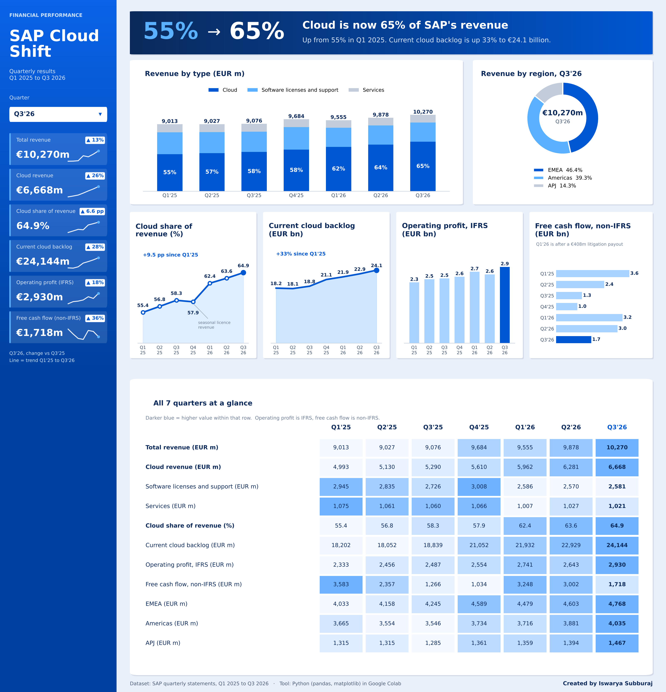

# SAP Cloud Shift: quarterly results dashboard

A dashboard built from SAP's own public quarterly statements (Q1 2025 to Q3 2026). It shows how cloud grew from 55% to 65% of SAP's revenue.

## What the data shows

- **Cloud share of revenue:** 55.4% (Q1 2025) to 64.9% (Q3 2026).
- **Current cloud backlog:** up 33% since Q1 2025, now EUR 24.1bn.
- **Q3 2026 vs Q3 2025:** total revenue +13%, cloud revenue +26%, operating profit (IFRS) +18%, free cash flow (non-IFRS) +36%.
- **Free cash flow dip in Q1 2026:** SAP states that cash flow was reduced by a EUR 408m payout for the Teradata litigation settlement.
- **Q4 2025 dip in cloud share:** software license revenue is seasonally high in Q4.

## Data source

SAP's "Quarterly Statement" PDFs, published on SAP's investor website:
https://www.sap.com/investors/en/financial-documents-and-events.html

Statements used: Q4 2025, Q1 2026, Q2 2026, Q3 2026. The 2025 quarters come from the prior-year comparison columns in the 2026 statements (and the Q4 2025 statement).

The typed data, with the source document and page numbers for each quarter, is in `sap_quarterly_data.csv`. All values are in EUR millions.

## Method

1. Read the four quarterly statements and typed the figures into a checked table.
2. Checked for every quarter that revenue types add up to total revenue, and that the three regions add up to total revenue (tolerance of 1 because of SAP's rounding).
3. Compared every figure against the PDF text a second time before publishing.
4. Built the dashboard in Python (pandas, matplotlib) in Google Colab, with a quarter filter and a table of all 7 quarters.

## How to run

1. Open [Google Colab](https://colab.research.google.com) and create a new notebook.
2. Paste the content of `sap_cloud_shift_dashboard.py` into one cell and run it.
3. Use the "View" dropdown to switch between the full page and a single quarter. "Save PNG" saves the current view.

The dropdown uses `ipywidgets`, which is built into Colab. Outside Colab, install the packages in `requirements.txt` and run it in Jupyter.

## Things to know about the data

- **Operating profit is IFRS. Free cash flow is non-IFRS.** SAP reports free cash flow and current cloud backlog only on a non-IFRS basis, so the two metrics are labelled separately and should not be mixed.
- **Rounding:** SAP rounds each line separately, so parts can differ from totals by 1. For "software licenses and support" the values follow the total line printed by SAP.
- **Reporting changes from 2027** (IFRS 18 and new non-IFRS adjustments) mean future quarters may not be directly comparable with this data.
- The "55% to 65%" headline in the banner is rounded (55.4% and 64.9%).

## Disclaimer

Personal project based on public data. Not affiliated with, endorsed by, or sponsored by SAP SE. Not investment advice.

## Author

Iswarya Subburaj, MSc Data Science student, Berlin.
